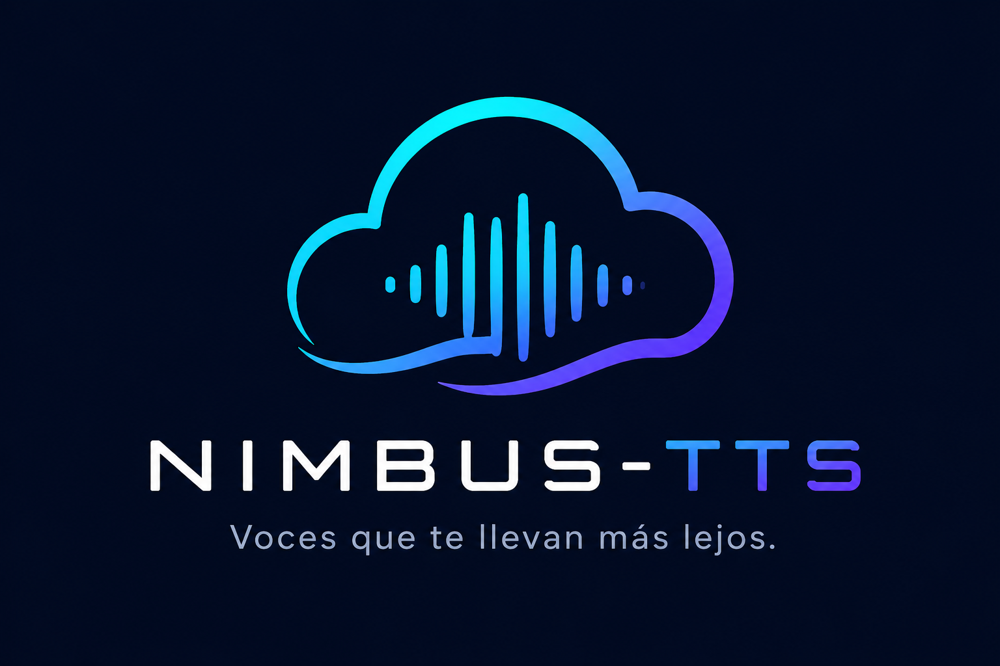

# Nimbus-TTS



Una app de escritorio para Windows que lee en voz alta PDFs y apuntes, con voces
naturales que funcionan sin internet.

## Por qué existe

Leo mucho en PDF: módulos de la facultad, apuntes, documentación. Para escuchar
en lugar de leer usaba el Lector inmersivo de OneNote, pero quedó bastante
abandonado: hay que pasar el texto a OneNote, las voces suenan robóticas y
depende de la nube. Quería algo que abriera el PDF directo y lo leyera bien, así
que me lo hice.

Es parte de Nimbus, la marca donde junto los proyectos que uso yo mismo.

## Qué hace

- **Abre PDFs y texto.** Arrastrás el PDF a la ventana o lo elegís desde el
  botón, y extrae el texto para leerlo. También se puede pegar texto a mano.
- **Lee sin internet.** Usa modelos de voz que corren en la propia PC: Kokoro,
  que suena muy natural, y Piper, más liviano. Las voces se descargan una vez
  desde Ajustes.
- **Con internet, suma voces en la nube** (Edge TTS). Si al abrir no hay
  conexión, pasa sola a las voces locales.
- **Resume antes de leer.** Si el texto es largo, el botón "Resumen IA" lo
  resume con Gemini u OpenAI (con tu propia clave) y podés escuchar el resumen.
- **Se controla desde cualquier app.** Queda en la bandeja del sistema, y con
  atajos globales pausás o cortás la lectura sin volver a la ventana
  (por defecto `Ctrl+Alt+P` y `Ctrl+Alt+S`, configurables).

## Instalación

Descargá `Nimbus-TTS.v1.0.0.exe` desde
[Releases](https://github.com/Nahuelito22/Nimbus-TTS/releases) y ejecutalo.
Después, en **Ajustes**, descargá al menos una voz para usarla sin internet.

Para el resumen con IA hace falta una clave de Gemini o de OpenAI, que se carga
en Ajustes.

## Correrlo desde el código

Requiere Python 3.12.

```bash
python -m venv .venv
.venv\Scripts\activate
pip install -r requirements.txt
copy config.example.json config.json
python main.py
```

El ejecutable se arma con PyInstaller (`Nimbus-TTS.spec`) y el instalador con
Inno Setup (`Nimbus-Setup-Script.iss`).

## Estado

La versión 1.0 está publicada y la uso. El proyecto está en pausa: la idea es
retomarlo para que lea PDFs escaneados (con OCR) y para poder mandarle texto
seleccionado desde cualquier app, sin tener que pegarlo.

## Stack

Python, CustomTkinter, Kokoro y Piper (ONNX), Edge TTS, pypdf, Gemini y OpenAI.

## Licencia

MIT. Hecho por [Nahuel Ghilardi](https://www.nahuelghilardi.com.ar).
